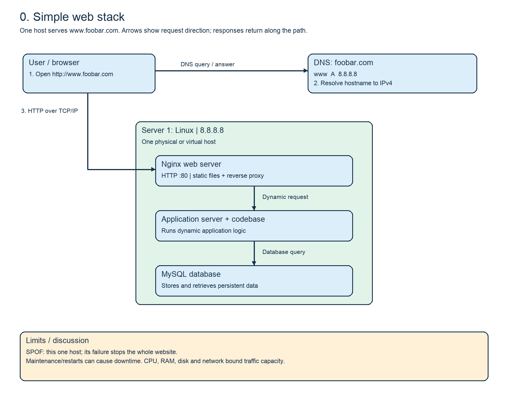
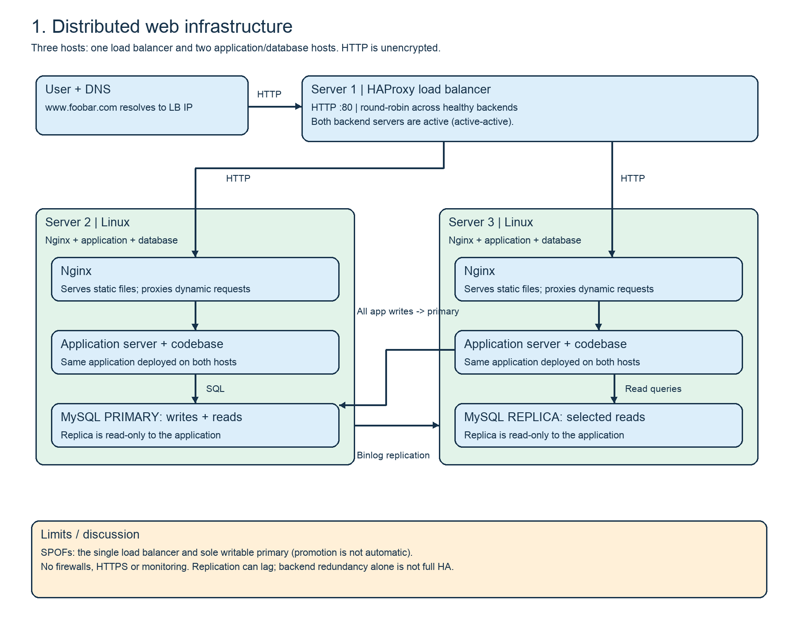
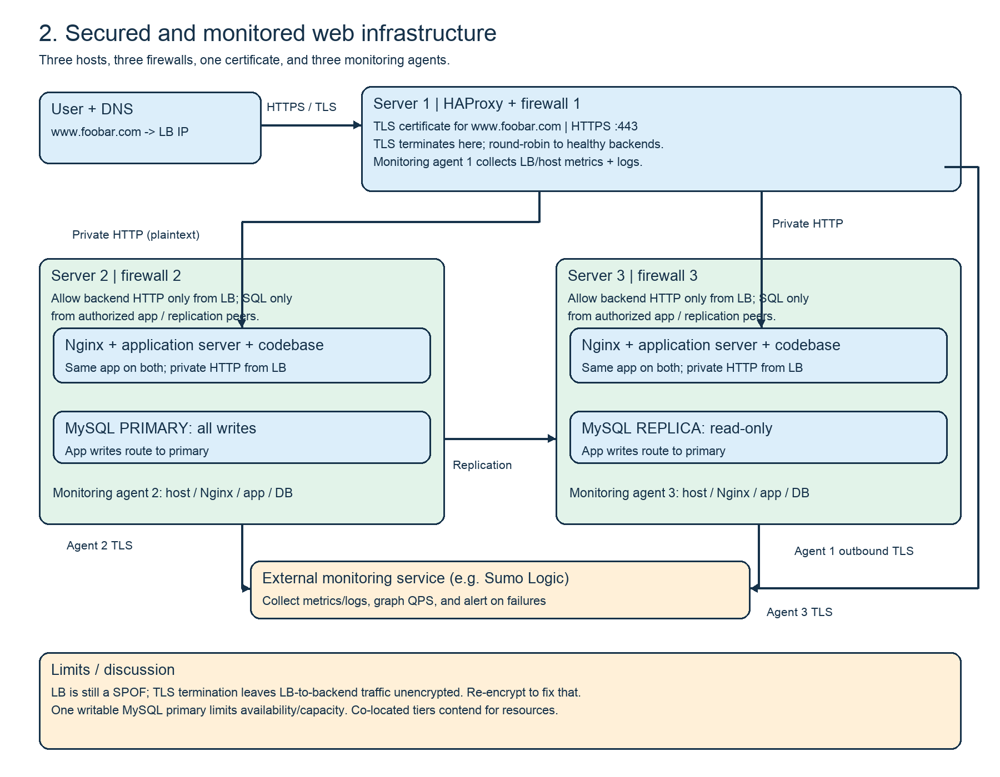
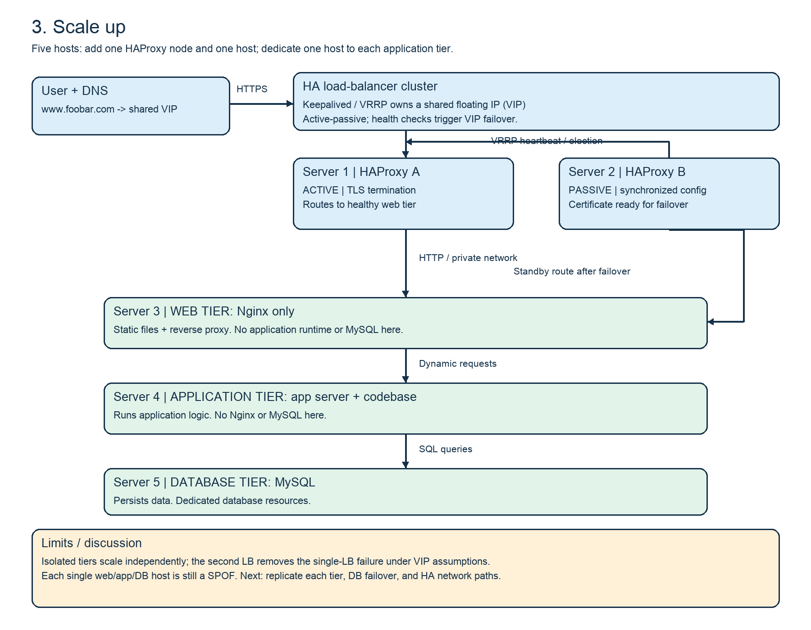

# Web infrastructure design

Four conceptual designs for `www.foobar.com`. The numbered answer files each
contain a publicly hosted diagram URL. PNG diagrams are in `diagrams/`.
These are designs for discussion, not deployed infrastructure. The address
8.8.8.8 is the task's illustrative server IP; it is actually Google's public DNS
address and is not an address to deploy this application to.

## 0. Simple web stack

A user enters `http://www.foobar.com`. DNS resolves the hostname through a `www`
**A record** in the `foobar.com` zone to `8.8.8.8`. The browser opens a TCP
connection to port 80 and sends an HTTP request. Nginx returns static assets or
proxies dynamic requests to the application server. The application executes the
codebase, queries MySQL when needed, and returns a response through Nginx to the
browser. Responses use HTTP over TCP/IP.

A server is a physical/virtual machine, or a program, providing services to
clients. Here the single Linux machine hosts every service. The domain name is
a memorable name mapped to an address by DNS. Nginx handles HTTP and static
content; the application server executes business logic; MySQL persists and
retrieves structured application data. Application files contain the code the
application server runs.

The machine is a single point of failure (SPOF). Restarting services or deploying
without a graceful strategy can interrupt service. CPU, RAM, storage I/O and
network bandwidth limit capacity; adding traffic cannot be handled indefinitely
by this one host.

## 1. Distributed web infrastructure

Three hosts: one HAProxy server and two Linux servers, each hosting Nginx, an
application server, the same codebase, and MySQL. DNS now points to HAProxy's
public IP. HAProxy distributes HTTP requests using **round-robin**: successive
requests go to successive healthy backends, wrapping around. Health checks remove
unhealthy backends from rotation.

The second backend increases application capacity and lets one backend continue
serving when the other is unavailable, subject to database availability. Both
backends actively receive traffic: this is an **active-active backend setup**.
An active-passive backend setup would keep a standby idle until the active
backend fails. There is only one load balancer, so the LB layer itself has no
redundant active-active or active-passive pair.

MySQL on server 2 is the primary; it accepts all application writes. MySQL on
server 3 is a read-only replica for selected reads. Replication copies the
primary's binary log events to the replica, which applies them to its data.
Both application instances connect to the primary for writes; the application
must explicitly route suitable reads to the replica. Asynchronous replication
can lag, so read-after-write operations may need the primary. Primary failure
requires a controlled promotion and reconnection; replication alone does not
provide automatic failover or backups.

HAProxy and the sole writable primary are SPOFs for ingress and writes
respectively. There are no firewalls, no HTTPS, and no monitoring. Requests and
credentials can be exposed on the network. A whole backend host failure can
remove both application capacity and a database node.

## 2. Secured and monitored web infrastructure

Keep the three-host topology from task 1 and add these controls:

- **Three host firewalls:** one on each host. The LB accepts public HTTPS on 443;
  backend HTTP is allowed only from the LB. SQL and replication are restricted
  to authorized private application/database peers. Administration is restricted
  to trusted administrative sources. Allow required DNS, monitoring egress and
  established reply traffic; deny unnecessary inbound traffic.
- **One certificate:** installed on HAProxy for `www.foobar.com`, with its private
  key protected. HTTPS uses TLS to encrypt traffic, protect integrity and
  authenticate the server to the browser. SSL is the older name in the task;
  modern implementations use TLS.
- **Three monitoring agents:** one per host. Agents collect resource metrics,
  service health, application/database metrics and logs, then send them over TLS
  to an external monitoring service such as Sumo Logic. Dashboards reveal trends;
  alerts notify operators about failures, latency and capacity problems.

To monitor Nginx QPS (queries/requests per second), expose its request counter
through a restricted status endpoint/exporter. Scrape the cumulative counter at
regular intervals and compute the increase divided by elapsed seconds, handling
counter resets. Sum across web instances for aggregate web-tier QPS; use access
logs as an alternative. Alert on abnormal rates and correlate with errors and
latency. An HTTP request rate is not the same as database query rate.

TLS terminates at the LB in this diagram. The browser-to-LB leg is encrypted,
but the LB-to-backend HTTP leg is plaintext and vulnerable if that network is
compromised. Re-encrypt and verify backend certificates (or use passthrough where
appropriate) to protect that leg. The LB remains a SPOF.

Only one MySQL node accepts writes, so its failure stops writes until promotion,
and it can become a write throughput bottleneck. Identical mixed-role hosts
couple scaling and maintenance: web, app and database compete for CPU/RAM/I/O;
a host failure affects several roles and increases the security impact. Separate
tiers reduce that coupling but still require redundancy.

## 3. Scale up

Use five hosts: two HAProxy nodes, one dedicated Nginx host, one dedicated
application host with the codebase, and one dedicated MySQL host. Compared with
the earlier three-host layout, add one HAProxy node and one additional host,
then redistribute the existing components across the three dedicated tier hosts.
This minimal exercise topology retains a single MySQL node and does not claim
to preserve the earlier replica or provide database HA.

The second HAProxy is a standby. Keepalived uses VRRP and health checks to move a
shared virtual IP (VIP) from the active node to the standby if the active fails.
DNS points to the VIP. This assumes a network/provider that supports VIP
failover, synchronized HAProxy configuration and certificates, and appropriate
health checks. Loss of a node may break existing connections; failover is not a
guarantee that in-flight requests survive. Heartbeat failure and split-brain
need careful handling. A shared upstream network can still be a SPOF.

Nginx handles HTTP/static files and proxies to the application host. The app
server runs application logic and connects to MySQL on the database host. The
extra host allows web, app and database roles to occupy independent machines.
Each tier can receive resources and maintenance independently; the standby LB
removes the failure of one LB node as the sole ingress failure under the stated
assumptions. Keep firewall restrictions, monitoring and TLS from task 2 when
implementing; the drawing focuses on the required role split and HA cluster.

Single web, application and database hosts remain SPOFs. Scaling further requires
multiple healthy instances in each tier, suitable routing, database replication
and controlled failover. The task's separate tiers alone do not provide full
end-to-end high availability.

## Whiteboard preparation

Start every explanation with the user and DNS, then trace one request and its
response. Name each host and service, explain why it exists, then identify
failure modes and the changes introduced by the next design. Practice drawing
each design without notes for the required live session.

- **LAMP:** Linux, Apache, MySQL, PHP (sometimes Perl/Python). These task designs
  use Nginx instead of Apache, so they are not literally the Apache-based LAMP stack.
- **SPOF:** single point of failure; losing it interrupts the service.
- **QPS:** queries per second; for a web server, the task uses this for request rate.
- **DNS:** Domain Name System. **HTTP:** Hypertext Transfer Protocol.
- **HTTPS:** HTTP secured with TLS. **TLS:** Transport Layer Security.
- **TCP/IP:** Transmission Control Protocol / Internet Protocol.
- **HA:** high availability. **VIP:** virtual IP address.
- **VRRP:** Virtual Router Redundancy Protocol.
- **System redundancy:** independent duplicate components that can continue a
  function when a component fails; redundancy requires working failover/routing,
  adequate remaining capacity and avoidance of shared failure domains.

## Review status

Diagrams and notes support the manual QA review. A human mentor, staff member or
student must conduct the required live whiteboarding and assign the final score.
